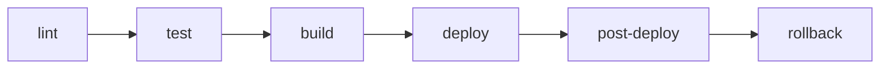

# Deployment Guide

This guide covers deploying the Portfolio application on traditional hosting (shared hosting, VPS, or dedicated server).

> **Note:** These instructions assume your local development environment is ready. The server only needs to serve the compiled files.
>
> Deploy can be done **manually** (SSH/FTP, documented here) or **automatically** via GitLab CI/CD with tags (see section 9).
>
> For a detailed step-by-step checklist, see [backend/DEPLOYMENT_CHECKLIST.md](backend/DEPLOYMENT_CHECKLIST.md).

---

## 1. Prerequisites

- PHP 8.2+
- Composer
- Node.js
- Ionic CLI
- MySQL database (provided by your hosting)
- Domain pointing to your hosting

---

## 2. Backend Deployment

### 1. Install Dependencies

```bash
cd backend
composer install --no-dev --optimize-autoloader
```

### 2. Configure Environment

Create the `backend/.env.production` file from the example and configure it with production values:

```bash
cp .env.production.example .env.production
```

| Variable | Description | Example |
|----------|-------------|---------|
| `APP_NAME` | Application name | `Portfolio` |
| `APP_ENV` | Environment | `production` |
| `APP_DEBUG` | Debug mode (false in prod) | `false` |
| `APP_URL` | Backend URL | `https://api.dowar.xyz` |
| `DB_CONNECTION` | Database driver | `mysql` |
| `DB_HOST` | MySQL host | `[mysql_host_from_provider]` |
| `DB_PORT` | MySQL port | `3306` |
| `DB_DATABASE` | Database name | `[database_name]` |
| `DB_USERNAME` | Database user | `[database_user]` |
| `DB_PASSWORD` | Database password | `[database_password]` |
| `SESSION_DRIVER` | Session driver | `database` |
| `MAIL_MAILER` | Mail driver | `smtp` |
| `MAIL_HOST` | SMTP server | `smtp.gmail.com` |
| `MAIL_PORT` | SMTP port | `587` |
| `MAIL_USERNAME` | SMTP user | `[your_email@example.com]` |
| `MAIL_PASSWORD` | SMTP password | `[your_password]` |
| `MAIL_ENCRYPTION` | Encryption (tls/ssl) | `tls` |
| `MAIL_FROM_ADDRESS` | Sender email | `noreply@dowar.xyz` |
| `MAIL_FROM_NAME` | Sender name | `Portfolio` |
| `SSO_URL` | SSO Server API URL | `https://sso.dowar.xyz/api` |

### 3. Upload Files

Upload the entire `backend/` folder to your hosting. Common paths:

- Shared hosting: `/home/[user]/[project_folder]/`
- cPanel: `/home/[user]/public_html/[project_folder]/`

### 4. Run Migrations

**Important:** The production environment uses `CACHE_STORE=database`, `QUEUE_CONNECTION=database`, and `SESSION_DRIVER=database`. These require the `cache`, `jobs`, and `sessions` tables.

Run these commands on your hosting (via SSH, terminal, or hosting panel):

```bash
# Generate optional table migrations (one-time)
php artisan cache:table    # Required for CACHE_STORE=database
php artisan queue:table    # Required for QUEUE_CONNECTION=database
php artisan session:table  # Required for SESSION_DRIVER=database (if used)

# Run all migrations (including optional tables)
php artisan migrate --force

# Verify everything is migrated
php artisan migrate:status

# Cache for production
php artisan config:cache
php artisan route:cache
php artisan view:cache
```

> **Note:** If `php artisan migrate` fails with "Table 'cache' doesn't exist", it means `cache:table` was not executed. The `post-autoload-dump` Composer hook runs `migrate --force` automatically on `composer install`, but `cache:table` and `queue:table` must be run manually the first time.

---

## 3. Frontend Deployment

### 1. Configure Environment

Create the `frontend/.env.production` file from the example:

```bash
cp .env.production.example .env.production
```

| Variable | Description | Example |
|----------|-------------|---------|
| `VITE_API_URL` | Laravel backend URL | `https://api.dowar.xyz/api` |
| `VITE_SSO_URL` | SSO Server API URL | `https://sso.dowar.xyz/api` |
| `VITE_SSO_FRONTEND_URL` | SSO web frontend URL | `https://sso.dowar.xyz` |
| `VITE_SSO_CLIENT_ID` | Client ID registered in SSO | `main-app` |

### 2. Build for Production

```bash
cd frontend
ionic build --prod
```

### 3. Upload Files

Upload the contents of `frontend/dist/` to your hosting public directory:

- Shared hosting: `/home/[user]/public_html/`
- The `index.html` and `assets/` folder must be directly accessible

---

## 4. Web Server Configuration

### Apache (.htaccess)

Place this in your public directory (where index.html is located):

```apache
RewriteEngine On

# API URL for prerender.php (change for staging overrides)
SetEnv API_URL "https://api.dowar.xyz"

# Social media bots → prerender.php (full HTML with OG/Twitter meta tags)
RewriteCond %{REQUEST_URI} ^/blog/post/[a-z0-9\-]+$ [NC]
RewriteCond %{HTTP_USER_AGENT} "facebookexternalhit|Facebot|Twitterbot|Twitter|WhatsApp|Googlebot|LinkedInBot|Slackbot|Discordbot|TelegramBot|Pinterestbot|Slurp|DuckDuckBot|Applebot|baiduspider|yandexbot|semrushbot|ahrefsbot|dotbot" [NC]
RewriteRule ^blog/post/([a-z0-9\-]+)$ /prerender.php?slug=$1 [L,QSA]

# SPA fallback (serve index.html for any non-file route)
RewriteCond %{REQUEST_FILENAME} !-f
RewriteCond %{REQUEST_FILENAME} !-d
RewriteRule . /index.html [L]
```

### SEO Prerendering

Social media crawlers (Facebook, Twitter, LinkedIn, WhatsApp, Google) do not execute JavaScript. The `.htaccess` rules redirect known bot user agents to `prerender.php`, which fetches the post data from the Laravel API and generates a full HTML page with Open Graph and Twitter Card meta tags.

The `prerender.php` reads the API URL from the `API_URL` environment variable (set via `SetEnv` in `.htaccess`). The fallback is `https://api.dowar.xyz`.

Configure per environment:

| Environment | `.htaccess` SetEnv |
|-------------|-------------------|
| Production | `SetEnv API_URL "https://api.dowar.xyz"` |
| Staging | `SetEnv API_URL "https://api-staging.dowar.xyz"` |

The site URL (used for `og:url`) is auto-detected from `HTTP_HOST`, so no additional configuration is needed per domain.

> **Note:** `.env.production` is not committed. It is generated on the server from `.env.production.example`.

### Nginx

```nginx
location / {
    try_files $uri $uri/ /index.html;
}
```

> **Note:** If your hosting uses a custom directory structure, adjust the paths accordingly. Contact your hosting provider for the correct paths.

---

## 5. SSL Configuration

Enable HTTPS through your hosting panel (most providers offer free Let's Encrypt certificates) or manually configure your SSL certificate.

After enabling SSL, update your `.env.production` files to use `https://` instead of `http://`.

---

## 6. Deployment Checklist

- [ ] Backend files uploaded to hosting
- [ ] Frontend files uploaded to public directory
- [ ] Database configured and migrations executed (`php artisan migrate:status` all "Ran")
- [ ] Optional cache/queue/session table migrations generated (`cache:table`, `queue:table`, `session:table` if needed)
- [ ] Environment variables configured for production
- [ ] SSO URLs updated to production domains
- [ ] SSL/HTTPS enabled
- [ ] Rewrite rules working (no 404 when navigating)
- [ ] Bot detection `.htaccess` rules uploaded (for SEO prerendering)
- [ ] `SetEnv API_URL` configured for correct environment
- [ ] Test authentication flow
- [ ] Check application logs for errors

---

## 7. Troubleshooting

### 404 when refreshing page (SPA)

Make sure rewrite rules are correctly configured in your `.htaccess` or server configuration.

### Database connection error

Verify your database credentials in `backend/.env.production`. Contact your hosting provider for the correct database host.

### Assets not loading

Verify that frontend files are in the correct public directory and that paths in `index.html` are correct.

### SSO authentication not working

Verify that `VITE_SSO_URL` and `SSO_URL` point to the production SSO server in your `.env.production` files.

### Table 'cache' doesn't exist

The `CACHE_STORE=database` driver requires the `cache` table. Run:
```bash
php artisan cache:table && php artisan migrate --force
```
Same applies for `queue:table` (`QUEUE_CONNECTION=database`) and `session:table` (`SESSION_DRIVER=database`).

See [section 2.4](#4-run-migrations) for details.

---

## 8. Domain Summary

| Service | Development | Production |
|---------|-------------|------------|
| Frontend | `http://localhost:8100` | `https://dowar.xyz` |
| Backend API | `http://localhost:8000` | `https://api.dowar.xyz` |
| SSO Server | `http://localhost:8001` | `https://sso.dowar.xyz` |
| SSO Frontend | `http://localhost:8101` | `https://sso.dowar.xyz` |

---

## 9. GitLab CI/CD Auto-Deploy (manual alternative)

The `.gitlab-ci.yml` files in `backend/` and `frontend/` enable automatic deploy when pushing a semantic tag.

### Prerequisites

Configure these variables in **GitLab → Settings → CI/CD → Variables**:

| Variable | Value | Protected | Masked |
|----------|-------|-----------|--------|
| `SSH_PRIVATE_KEY` | Server SSH private key | ✅ | ✅ |
| `SSH_HOST` | `your-server.com` | ✅ | ✅ |
| `SSH_PORT` | `22` | ✅ | ✅ |
| `SSH_USER` | `your-ssh-user` | ✅ | ✅ |
| `DEPLOY_PATH_BACKEND` | `/home/your-user/path/to/backend` | ✅ | ❌ |
| `DEPLOY_PATH_FRONTEND` | `/home/your-user/path/to/frontend` | ✅ | ❌ |
| `VITE_API_URL` | `https://api.yourdomain.com/api/` | ✅ | ❌ |

### Deploy trigger

```bash
git tag -a v1.0.0 -m "Release 1.0.0"
git push origin v1.0.0
```

The pipeline runs **only on tags** matching `vX.Y.Z`:

- **Backend**: `lint` → `test` → `build` → `deploy` (tar+scp, runs `php artisan migrate --force`)
- **Frontend**: `lint` → `test` → `build` → `deploy` → `post-deploy` → `rollback` (uploads compressed `dist/`)

Normal pushes to `main` **do not trigger deploy**. Only semantic tags.

### Validation deploys (dryrun)

To exercise the pipeline end-to-end against the real server without polluting
release history, push a tag with the `-dryrun.N` suffix:

```bash
git tag -a v0.0.0-dryrun.1 -m "dryrun: validate CI changes against server"
git push origin v0.0.0-dryrun.1
# ... watch pipeline, verify behaviour ...
git tag -d v0.0.0-dryrun.1
git push origin :refs/tags/v0.0.0-dryrun.1
```

The pipeline accepts `vX.Y.Z`, `vX.Y.Z-alpha.N`, `vX.Y.Z-beta.N`,
`vX.Y.Z-rc.N`, and `vX.Y.Z-dryrun.N`. Anything else is ignored.

### Pipeline sequence (frontend)



`rollback` is manual (`when: manual`), so it does not run automatically on success. The remaining stages are sequential: if `lint`, `test`, or `build` fails, the pipeline stops and won't deploy. `post-deploy` runs after a successful `deploy` and is itself followed only by the optional manual `rollback`.
